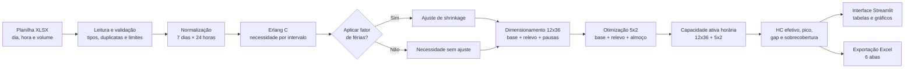

# Dimensionamento de capacidade

Ferramenta de apoio ao planejamento de equipes de atendimento. A partir de uma planilha semanal de demanda por hora, estima a necessidade de atendentes e monta uma capacidade planejada com escalas 12x36 e 5x2, pausas, headcount e exportação para Excel.

> **Importante:** o resultado é uma estimativa para planejamento. Não representa escala publicada, disponibilidade observada, previsão em tempo real nem garantia de nível de serviço.

## Visão do produto

O produto ajuda analistas de capacidade e gestores a responder perguntas como:

- Quantos atendentes simultâneos são necessários em cada intervalo para atingir uma meta de espera?
- Como a necessidade se traduz em uma escala-base 12x36 e em cobertura comercial 5x2?
- Quantas posições estão ativas — e quantas estão em pausa — ao longo da semana?
- Qual é o headcount efetivo contratado, separado da capacidade simultânea?

O fluxo vigente é a aplicação `app_dimensionamento5.py`, com cálculos de domínio em `staffing_model.py`. Os aplicativos `app_dimensionamento.py` até `app_dimensionamento4.py` são versões históricas; não são os pontos de entrada documentados aqui.

## O que faz

1. Lê uma planilha `.xlsx` com demanda agregada por dia da semana e hora.
2. Valida e normaliza os dados em uma grade semanal de 168 intervalos (7 dias × 24 horas).
3. Calcula a necessidade por intervalo com Erlang C e os parâmetros informados.
4. Opcionalmente ajusta a necessidade para o fator de férias configurado.
5. Dimensiona base e relevo para as escalas 12x36 e 5x2, dentro das janelas e horários implementados.
6. Programa pausas e calcula capacidade ativa por intervalo, pico simultâneo, gaps e sobrecobertura.
7. Apresenta tabela e gráficos no Streamlit e permite baixar um XLSX com os resultados.

### Diagrama do fluxo



## Como funciona o cálculo

### Erlang C: da demanda ao número simultâneo de atendentes

Erlang C é um modelo clássico de teoria das filas para estimar a probabilidade de uma solicitação aguardar e o tempo médio em fila em um sistema com uma fila compartilhada e atendentes equivalentes.

No aplicativo:

- `λ` é a taxa de chegada por minuto, calculada como `volume_mensagens / 60`.
- `TMR` é o tempo médio de atendimento em minutos.
- `simultaneidade` representa quantos contatos podem ser tratados simultaneamente por atendente (no uso atual, o parâmetro é compartilhado para o conjunto de canais selecionado).
- `efetividade` é a proporção configurada entre 0,10 e 1,00.
- `μ`, taxa efetiva de atendimento por atendente, é calculada como:

  ```text
  μ = (simultaneidade / TMR) × efetividade
  ```

Para uma hipótese de `c` atendentes:

```text
a = λ / μ
ρ = λ / (c × μ)
```

`ρ` é a utilização estimada. Quando `ρ ≥ 1`, a capacidade de atendimento não supera as chegadas; o código considera a probabilidade de espera igual a 1 e o tempo de espera infinito.

Quando `ρ < 1`, a probabilidade de uma chegada aguardar é:

```text
                    (a^c / c!) × 1 / (1 − ρ)
P(espera) = ───────────────────────────────────────────
             Σ[n=0…c−1](a^n / n!) + (a^c / c!) × 1/(1−ρ)
```

O tempo médio estimado em fila (antes do atendimento) é:

```text
Wq = P(espera) / (c × μ − λ)
```

`Wq` é expresso em minutos porque as taxas são convertidas para minuto. O aplicativo percorre valores crescentes de `c` e escolhe o menor número inteiro que satisfaz `Wq ≤ espera-alvo`. O cálculo retorna zero de necessidade quando o volume é zero ou negativo; a planilha de entrada, porém, não aceita volumes negativos.

A implementação limita a busca a 200 atendentes. Se nenhum valor até esse limite satisfizer a meta, retorna uma indicação de espera infinita em vez de apresentar uma solução viável.

**Como interpretar:** volume maior ou TMR maior tende a exigir mais atendentes; aumentar simultaneidade ou efetividade aumenta a capacidade efetiva por atendente; uma meta de espera mais rigorosa tende a elevar `c`. O resultado depende dos parâmetros e da hipótese de fila agregada.

**Pressupostos e limites do modelo:** Erlang C pressupõe uma fila compartilhada, chegadas e tempos de serviço representáveis pelas hipóteses clássicas do modelo, atendentes equivalentes e ausência de abandono da fila. A implementação não simula eventos individuais nem distingue skill, prioridade ou canal dentro da fila agregada. Portanto, deve ser usada como estimativa de planejamento, não como previsão exata de espera real.

### Fator de férias (shrinkage)

Quando ativado, o fator configurado ajusta a necessidade positiva:

```text
necessidade_ajustada = teto(necessidade / (1 − fator_de_férias))
```

O arredondamento é para cima. Uma necessidade zero permanece zero. O fator padrão na interface é `1/12` (aproximadamente 8,33%); ele pode ser alterado ou desativado.

### Escalas, pausas e capacidade

- **12x36 diurno:** base dimensionada pelo pico semanal da necessidade ajustada às 06h ou 07h; equipe cobre o turno 06h–18h.
- **12x36 noturno:** base dimensionada pelo pico semanal entre 18h e 05h; equipe cobre o turno 18h–06h.
- **Relevo 12x36:** equipe adicional dimensionada para manter a capacidade-base durante as pausas programadas. A janela diurna é 11h–15h; a noturna é 21h–01h. O intervalo 00h–01h pertence ao turno noturno iniciado no dia anterior no relógio.
- **5x2:** cobre a necessidade comercial residual em dias úteis, com entradas às 08h e 09h e saídas às 17h e 18h. A base e o relevo são otimizados respeitando a cobertura horária e o almoço.
- **Capacidade ativa:** quantidade de posições/pessoas efetivamente escaladas e não pausando naquele intervalo. Relevo também contribui para a capacidade fora das pausas.
- **HC efetivo:** medida de pessoas contratadas, não de capacidade simultânea:

  ```text
  HC 12x36 = 2 × (base diurna + relevo diurno + base noturna + relevo noturno)
  HC 5x2   = base 5x2 + relevo 5x2
  HC total = HC 12x36 + HC 5x2
  ```

  O fator 2 do 12x36 representa alternância de pessoas para cobrir os postos. Ele **não** duplica posições ativas nem posições em pausa no turno.

O **pico simultâneo planejado** é calculado a partir da capacidade ativa horária e exibido separadamente do HC efetivo.

## Planilha de entrada

O aplicativo lê a primeira planilha (aba) do arquivo Excel `.xlsx`. Ela deve conter estas colunas:

| Coluna | Tipo esperado | Regra |
|---|---|---|
| `dia_da_semana` | Texto | Dia em português: `segunda`, `terça`, `quarta`, `quinta`, `sexta`, `sábado` ou `domingo`. O normalizador também aceita algumas formas com `-feira` e sem acento. |
| `hora` | Número inteiro | Hora de início do intervalo, de `0` a `23`. Por exemplo, `9` representa 09:00–10:00. |
| `volume_mensagens` | Número | Volume agregado para aquele dia e intervalo, finito e maior ou igual a zero. |

Cada combinação de dia e hora deve aparecer no máximo uma vez. O sistema rejeita dias inválidos, horas fora da faixa ou fracionárias, valores não numéricos/não finitos, volumes negativos e duplicatas de dia/hora. Combinações ausentes são completadas com volume zero.

### Como construir a planilha-base

1. Crie uma aba com uma linha de cabeçalho contendo os três nomes de coluna **exatamente** como acima.
2. Monte uma linha para cada combinação entre os sete dias e as 24 horas — **168 linhas de dados** no total.
3. Registre cada hora pelo seu início (0 a 23), sempre como inteiro.
4. Agregue o volume de mensagens por dia e hora para o conjunto de canais escolhido na aplicação.
5. Preencha horários sem movimento com zero. Embora o aplicativo complete linhas ausentes como zero, explicitar os 168 registros facilita revisão e evita interpretar lacunas acidentais como demanda nula.
6. Não misture unidades, períodos ou conjuntos de canais diferentes na mesma coluna.
7. Salve como `.xlsx`.

Exemplo demonstrativo mínimo (linhas parciais; não substitui a grade de 168 linhas):

| dia_da_semana | hora | volume_mensagens |
|---|---:|---:|
| segunda | 8 | 42 |
| segunda | 9 | 67 |
| segunda | 10 | 51 |

Outro exemplo de cenário de pico, também sintético:

| dia_da_semana | hora | volume_mensagens |
|---|---:|---:|
| quarta | 13 | 38 |
| quarta | 14 | 124 |
| quarta | 15 | 46 |

Os números acima são apenas ilustrativos, não são resultados observados nem um benchmark. A opção **Conjunto de canais da planilha** e os parâmetros de TMR/simultaneidade/efetividade devem corresponder ao mesmo agregado representado na coluna `volume_mensagens`.

## Como iniciar

### Requisitos

- Python 3 instalado.
- Acesso à internet na primeira execução para instalar as dependências.
- Sistema compatível com Python, Streamlit e o solucionador HiGHS usado pelo PuLP. O projeto não publica uma matriz de sistemas operacionais testados.

### Caminho recomendado — macOS/Linux

Na pasta do projeto:

```bash
./run_dimensionamento.sh
```

O script cria `.venv` se necessário, instala ou verifica `requirements.txt` e inicia o aplicativo com Streamlit. Depois abra o endereço local exibido no terminal (normalmente `http://localhost:8501`).

Se a permissão de execução do script estiver ausente:

```bash
bash run_dimensionamento.sh
```

### Inicialização manual

```bash
python3 -m venv .venv
source .venv/bin/activate        # macOS/Linux
python -m pip install -r requirements.txt
streamlit run app_dimensionamento5.py
```

No Windows, crie/ative o ambiente virtual (`.venv\Scripts\activate`), instale `requirements.txt` e execute:

```powershell
streamlit run app_dimensionamento5.py
```

O arquivo `run_dimensionamento.bat` apenas chama Streamlit; ele pressupõe que Python, dependências e ambiente já estejam preparados.

### Passos de uso

1. Inicie o app e carregue o `.xlsx` no painel **Configuração**.
2. Selecione o conjunto de canais correspondente ao volume agregado.
3. Informe espera-alvo, TMR, simultaneidade e efetividade.
4. Ative/desative o fator de férias e ajuste seu valor conforme o cenário.
5. Revise necessidade, capacidade planejada, HC efetivo, pico, pausas e cobertura horária.
6. Selecione o dia do turno para examinar pausas simultâneas desse dia; o detalhe semanal permanece disponível.
7. Baixe o relatório `.xlsx` e valide premissas/resultados antes de usá-los em decisões operacionais.

## Parâmetros disponíveis

| Parâmetro | Padrão | Interpretação |
|---|---:|---|
| Espera-alvo | 5 min | Limite de tempo médio estimado em fila usado para escolher a necessidade. |
| TMR | 30 min | Tempo médio de atendimento usado no cálculo de capacidade por agente. |
| Simultaneidade | 7 | Contatos simultâneos por atendente no modelo agregado. |
| Efetividade | 85% | Multiplicador da taxa de atendimento efetiva. |
| Fator de férias | 1/12 | Ajuste opcional de shrinkage; o checkbox permite não aplicar. |

Esses padrões são apenas valores iniciais da interface. O usuário deve validá-los para a operação analisada.

## Resultados e exportação

O XLSX exportado contém seis abas:

| Aba | Conteúdo |
|---|---|
| `parametros` | Canal/conjunto de canais e premissas usadas. |
| `necessidade_estimada` | Demanda, necessidade por intervalo, espera estimada e necessidade ajustada. |
| `headcount_camadas` | Base, relevo, unidades dimensionadas e HC efetivo, com subtotais. |
| `pausas` | Atribuições detalhadas de pausas por turno, camada, dia e horário. |
| `pausas_por_janela` | Contagem de posições em pausa por dia/turno/intervalo; dias não são somados como se fossem simultâneos. |
| `cobertura_horaria` | Necessidade, capacidades 12x36 e 5x2, capacidade planejada, gap e sobrecobertura por intervalo. |

As contagens de pausa representam posições simultaneamente em pausa no turno/dia/horário, não o total semanal. O HC contratado, a capacidade ativa e a necessidade são medidas diferentes; não devem ser somadas ou comparadas como se tivessem a mesma unidade.

## Pontos fortes

- Caminho rastreável da entrada horária até a necessidade, composição da escala, capacidade e exportação.
- Separação explícita entre necessidade estimada, capacidade planejada, pico simultâneo e HC efetivo.
- Consideração de turnos 12x36, cobertura residual 5x2, relevo e pausas na capacidade ativa.
- Grade semanal completa e saídas detalhadas, úteis para revisar premissas e explicar o resultado.
- Testes automatizados para cálculos, casos de entrada, interface e reconciliação da planilha de saída.

## Limitações e o que não faz

- Não estima disponibilidade observada nem prevê a operação em tempo real.
- Não importa dados diretamente de telefonia, CRM, WFM ou sistemas de atendimento; a entrada é um `.xlsx` preparado pelo usuário.
- Não dimensiona múltiplas skills, prioridades, filas segregadas ou roteamento entre canais. O conjunto de canais é modelado de forma agregada.
- Erlang C é uma aproximação; não modela abandono, eventos individuais, sazonalidade intrahorária ou variação individual dos tempos de atendimento.
- Escalas, janelas de refeição e horários de entrada são regras fixas do modelo atual, não um editor genérico de jornadas nem uma otimização irrestrita de escalas.
- A qualidade depende da consistência do volume, TMR, simultaneidade, efetividade e shrinkage fornecidos pelo usuário.
- O resultado não substitui validação por analista, regras trabalhistas, acordos locais ou sistemas oficiais de publicação de escala.

## Desenvolvimento e testes

Instale os requisitos de desenvolvimento e rode os testes:

```bash
python -m pip install -r requirements-dev.txt
python -m pytest tests -q
```

Verificações adicionais:

```bash
python -m compileall -q staffing_model.py app_dimensionamento5.py
python -m pip check
```

Estrutura principal:

```text
.
├── app_dimensionamento5.py   # Interface, gráficos e exportação Streamlit
├── staffing_model.py         # Normalização, filas, escalas, pausas, capacidade e HC
├── tests/                    # Testes de modelo, interface e tema
├── requirements.txt          # Dependências de execução
├── requirements-dev.txt     # Dependências de desenvolvimento
├── run_dimensionamento.sh    # Inicialização recomendada em macOS/Linux
└── .streamlit/config.toml     # Tema visual do app
```

## Licença

Este projeto está licenciado sob a [MIT License](LICENSE). A licença permite uso, cópia, modificação e distribuição, desde que os avisos de copyright e licença sejam preservados; o software é fornecido sem garantia.
